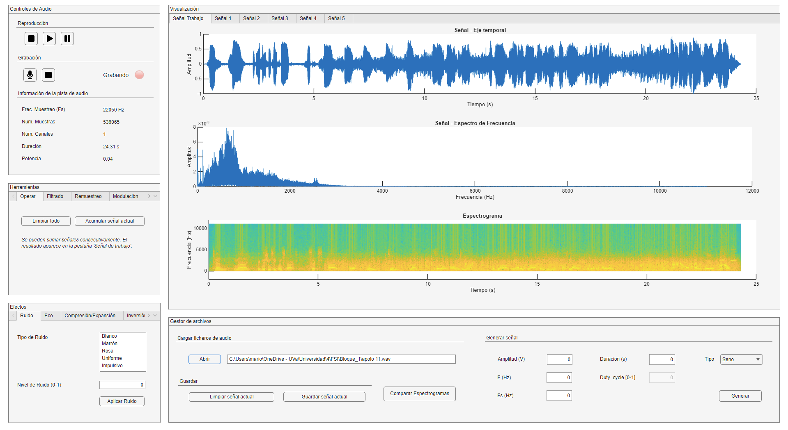
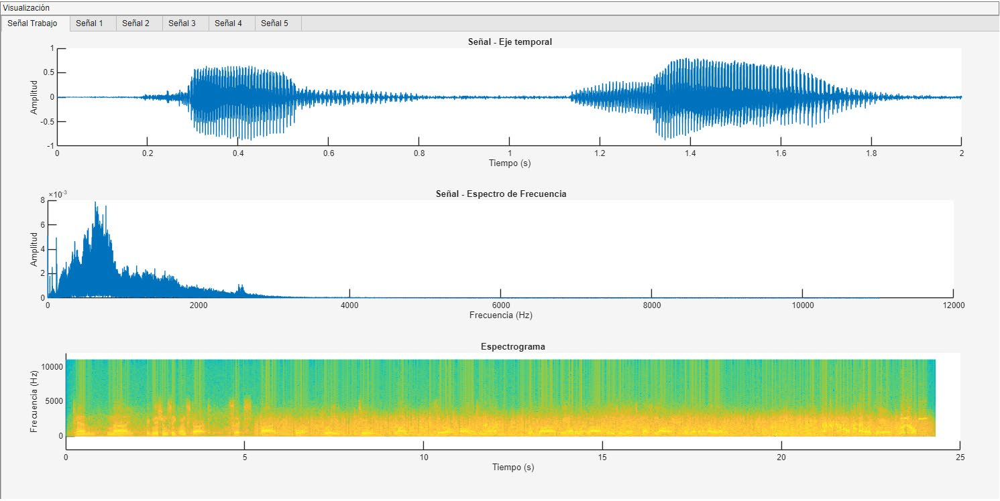

# Audio workbench in MATLAB

A desktop application for recording, visualising, processing and analysing audio, built in MATLAB App Designer for the signal processing labs of the telecommunications degree at the University of Valladolid. With Mario Medrano.

<p align="center">
  
</p>

## What it does

Up to six signals open at once, each in its own tab with its own player and processing chain. Load or record, look at it three ways, apply something, listen, compare.

- **Signals**: open and save `.wav`, record from the microphone, or synthesise sine, cosine, square, rectangular, triangular, sawtooth and chirp with amplitude, frequency, sample rate, duration and duty cycle.
- **Views**: time waveform with a playback cursor, single-sided FFT magnitude, spectrogram. Stereo-aware.
- **Tools**: sum of up to five signals; Butterworth low-, high-, band-pass and band-stop filters applied zero-phase with `filtfilt`; resampling by target rate or by interpolation and decimation factors; AM, FM, PM, ASK and FSK modulation with Hilbert-based demodulation; N-bit quantisation; sample-and-hold and linear reconstruction.
- **Effects**: white, brown, pink, uniform and impulsive noise; echo with cascaded repeats; reversal; reverb, Haas stereo widening and frequency masking; time-scale compression and expansion.
- **Transcription**: speech to text through Whisper large-v3-turbo on the Hugging Face inference API.
- **Comparison window**: two signals side by side, waveforms and spectrograms.

<p align="center">
  
</p>

## Layout

```
Bloque_1/P1.mlapp     the application
Bloque_1/Audios/      sample material
Bloque_1/Memorias/    lab reports (Spanish)
Bloque_2/             the follow-up practices: image and video processing scripts and reports
docs/images/          screenshots
```

MATLAB R2024b with the Signal Processing and Audio toolboxes. Open `P1.mlapp` in App Designer and run.
